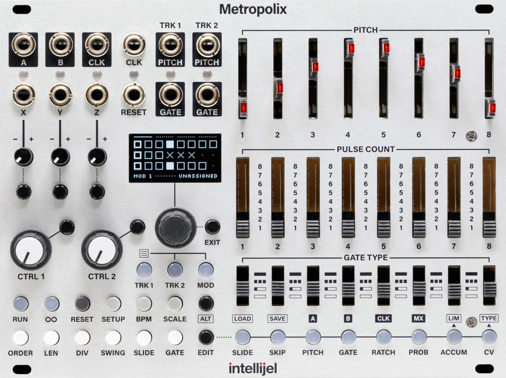

# Hardware panel target

User direction, 2026-10-12: the finished plugin UI must look exactly like the real Metropolix. The current development UI is acceptable temporarily. Work should converge on the hardware panel shown in the supplied photograph. This requirement supersedes the earlier hybrid-panel visual direction.

Additional user requirement: add computer/VCV interaction conveniences to that matching design, including mouseover text and right-click menus on appropriate buttons. Visual fidelity must coexist with practical desktop operation.

The reference image is saved in the project so it survives deletion of the temporary clipboard attachment. Use the supplied firmware 1.6 manual to resolve control functions and display states. The photograph establishes the visual target; it is not evidence that our engine behaves identically to the hardware.

## Required final appearance

- Match the real panel's proportions, spacing, control positions, lettering, markings, and artwork. Use the reference's silver brushed-metal panel, black printing, thin grouping lines, and mounting details.
- Place the two-row jack bank at the upper left, including A/B, clock, reset, X/Y/Z, and both tracks' pitch/gate connections. Match the input/output label treatment and jack appearance.
- Reproduce all eight right-side stage columns: tall pitch faders with red illumination, vertical pulse-count switches with their printed scales, and gate-type switches with their symbols. Match their relative heights, widths, and spacing.
- Reproduce the left-side X/Y/Z controls, two large CTRL knobs, small display, push encoder, EXIT, and TRK 1 / TRK 2 / MOD selection buttons in their hardware positions.
- Reproduce the bottom transport, setup, performance, and stage-function buttons, including their secondary labels and illuminated states.
- Keep the black display with pale cyan graphics at the hardware location and size. Implement the corresponding screen views and selection feedback as functionality becomes available.
- Draw sharp lettering and panel artwork at Rack zoom levels, with appropriate texture, shadows, and component detail. Controls must be interactive components aligned with the artwork; a static photograph alone does not satisfy the requirement.

## Interaction and optional editing aids

The hardware's controls and display define the panel's appearance and musical functions. Consult the manual for navigation, encoder actions, shifted functions, and indicators. Add direct desktop access to those functions: hardware button combinations and display navigation must not be the only way to reach settings when a tooltip, context menu, or numeric field would make computer use easier.

Required desktop interactions:

- **Mouseover text:** identify controls and ports, show current values with appropriate units or note names, and briefly explain their purpose. Include the selected track/stage/MOD lane when it affects meaning. Explain available right-click actions and useful modifiers. Keep help text concise and accurate as the selection changes.
- **Context menus on relevant controls:** provide direct choices and related settings. For example, ORDER can offer play orders, SCALE can offer root/scale selection, a track button can expose that track's settings, and MOD controls can expose lane setup and routing. Label stage-, lane-, and track-wide options clearly. Preserve the module's normal Rack context menu outside individual controls.
- **Precise editing:** support direct numeric entry, fine adjustment, and reset to defaults where appropriate for knobs, sliders, and numeric parameters. Use consistent Rack interaction conventions and preserve ordinary cable/port behavior.
- **Held vertical dragging:** the user explicitly requires holding the left mouse button and moving upward to increase a value, downward to decrease it, including numeric fields and value-bearing buttons. Short clicks retain their selection/toggle action; a drag must not also toggle on release. Navigation-only buttons need no numeric behavior.
- **Undo and persistence:** edits made through menus, numeric entry, and physical-looking controls must update the same underlying Rack parameters, support undo/redo, and survive saving/loading. Alternate access must not create separate copies of a setting.
- **Discoverability without permanent panel changes:** display these conveniences on hover, right-click, or in an optional editor. The default front panel retains the hardware layout and artwork. Useful context menus need not be added to buttons that have no secondary settings.

The current expanded stage/MOD grids are development tools. They can remain available as optional editors, accessed through a context menu or separate view without changing the appearance of the default hardware panel. Their current placement, colors, panel size, and extra front-panel buttons are not requirements for the final design.

## Implementation order and review

The user completed testing of the working 2.1.0 build on 2026-10-12 and reported that it is functional and satisfactory for now. Preserve that accepted engine and signal behavior while implementing the hardware panel and desktop interactions described here.

1. Map all physical controls and panel coordinates from the reference and manual. Establish the hardware dimensions before finalizing Rack width.
2. Build the matching panel artwork and component styles; bind existing functions while preserving patch compatibility and undo.
3. Add the hardware display/navigation states and desktop conveniences as their engine features become available. A visible control must clearly reflect whether its function is implemented during development; its tooltip can explain that status.
4. Compare rendered front-panel screenshots against the reference at the same scale. Check positions, proportions, typography, colors, faders, switches, jacks, knobs, LEDs, and display separately.
5. Verify mouseover text, direct menu access, normal/fine dragging, numeric entry, undo/redo, and save/load at normal Rack zoom. Check that menus act on the indicated track/stage/lane, primary clicks retain their intended action, and tooltips do not obstruct interaction.

Continue describing the plugin as an independent implementation in the project documentation. Visual fidelity and behavioral fidelity are separate acceptance checks; neither establishes the other.

## First implementation — 2.2.0

The default panel now uses the 34 HP hardware proportions and photographed arrangement, with interactive vector jacks, faders, switches, knobs, display, and buttons. Optional grids open through menus and expand to 66 HP. Existing parameter/port IDs remain unchanged. Hover help, contextual settings, direct numeric entry, vertical dragging, and undo/redo are implemented for current engine features. See `HARDWARE-UI.md` for operation and scope.

This is not yet a pixel-perfect recreation. Typography, component artwork, display pages, hardware long-press navigation, and secondary functions remain subjects for refinement. Unimplemented engine features are represented by controls with explicit status help. As of 2.4.0, X/Y/Z are patchable AUX inputs with working knobs, assignment buttons, and manual-based display meters. The earlier 2.1.0 user acceptance applies to the musical baseline, not to each later interface addition.

## Display and component refinement — 2.3.0

The panel now uses closer bold lettering, revised control caps and slider grips, metal socket highlights, blue/cream button colors, boxed secondary labels, corrected connection marks, mounting details, and a vector trace of the manual's logo. The live display uses a 128 × 64 pixel canvas based on the manual's native screen images. All four HOME views are present, with manual-based field layouts, selection corners, scale keyboard, and stage-edit diagrams. Encoder actions, MOD lane selection, tap tempo, and stage button colors have been refined alongside these views.

Manual references: HOME pp.28–31; BPM/scale pp.60–62; order/length/division pp.70,75,77; slide/gate pp.80,82; stage editing pp.85–104; output assignment pp.115–117; MOD pp.137–141. `tests/DisplayQa.hpp` captures the implemented screens for direct comparison. Photographic texture/lighting, some glyphs and animation details, destination-specific MOD units, long-press shortcuts, and unavailable firmware features still require work. This is a refinement milestone, not a declaration of exact fidelity.
